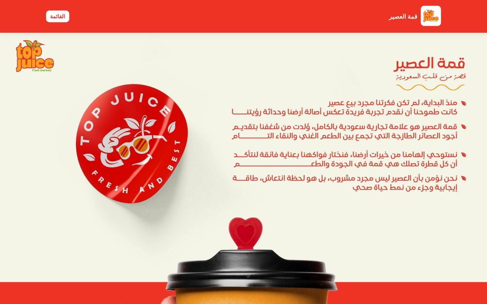
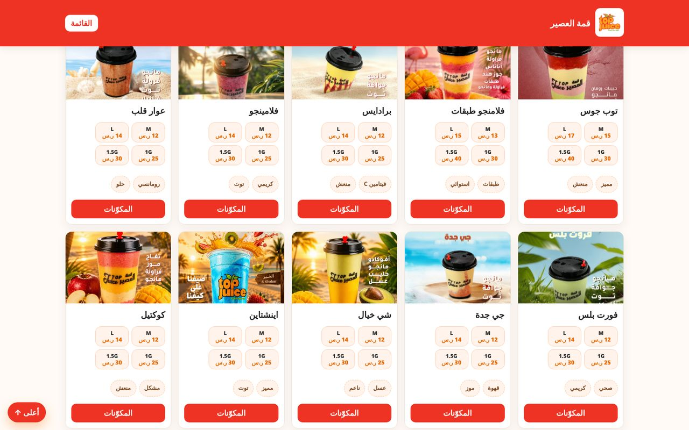
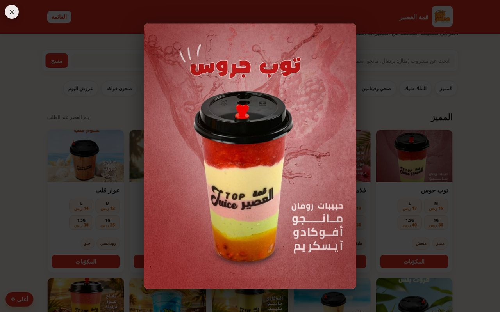
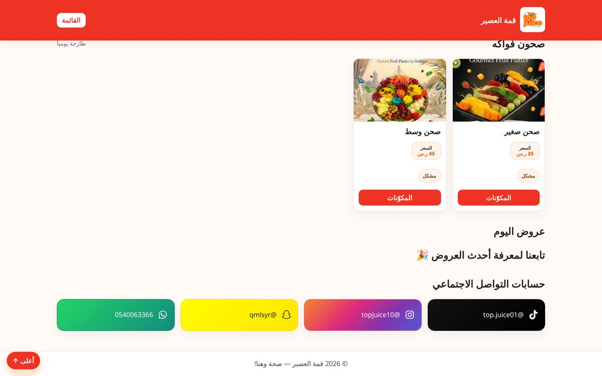
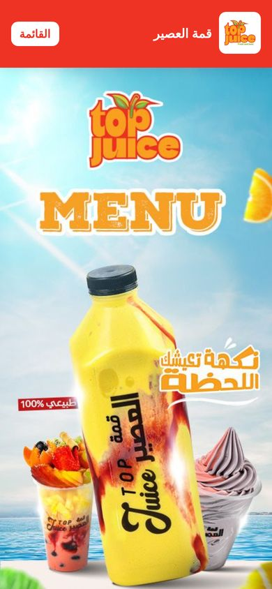

# Top Juice — Arabic Menu Website

The menu website of a Saudi juice shop, built with HTML, CSS and vanilla JavaScript. It is live at **[top-juice.vercel.app](https://top-juice.vercel.app)**.

<p align="center">
  
  
</p>
<p align="center">
  
  
</p>
<p align="center">
  
  
</p>

## Overview
Visitors can browse product cards, filter products by name and open larger product images. The site is a static frontend; it does not implement checkout, payments or a backend.

## Features
- Product-name search with a clear action.
- Mobile navigation and section scrolling.
- Image lightbox with loading fallback and Escape-key dismissal.
- Back-to-top navigation.

## Tech stack
HTML5, CSS3 and vanilla JavaScript.

## Run locally
Clone the repository, then serve its root with a static HTTP server:
```bash
python3 -m http.server 8080
```
Open http://localhost:8080. No npm installation, build step, database or environment variables are required.

## Structure
- `index.html`: menu markup and product content.
- `CSS/`: styles.
- `script.js`: search, navigation and image interactions.
- `Image/`: product images.

## Performance work
- The repository shrank from about 170 MB to 11 MB:
  - removed 12 unused images, including two 13 MB photos
  - resized product photos to at most 900 px (hero images to 1920 px)
  - re-encoded opaque PNG photos as progressive JPEG
  - replaced an unused 24 MB Font Awesome package with four inline SVG icons
- Product images load lazily (`loading="lazy"`, `decoding="async"`).
- The social icons were missing because the icon font was never linked. They now render as inline SVG.
- Added the favicon files the page already referenced, which used to return 404.

## Live demo
[top-juice.vercel.app](https://top-juice.vercel.app). The search, lightbox, mobile navigation and social links were checked in headless Chrome on 24 November 2026.

## Contribution
The repository contains commits linked to [hemo-n90](https://github.com/hemo-n90). This describes the application, not a claim that all assets or third-party libraries were authored by one person.

## Next improvements
Serve WebP/AVIF with `<picture>` fallbacks; add keyboard focus management to the lightbox; respect reduced-motion preferences.
